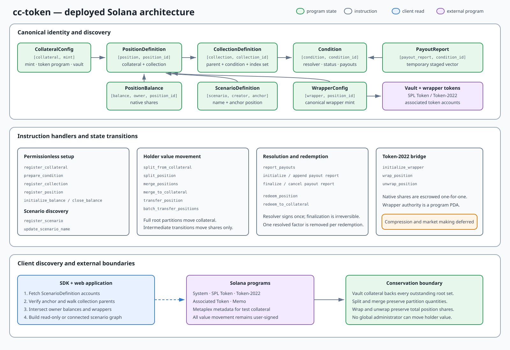
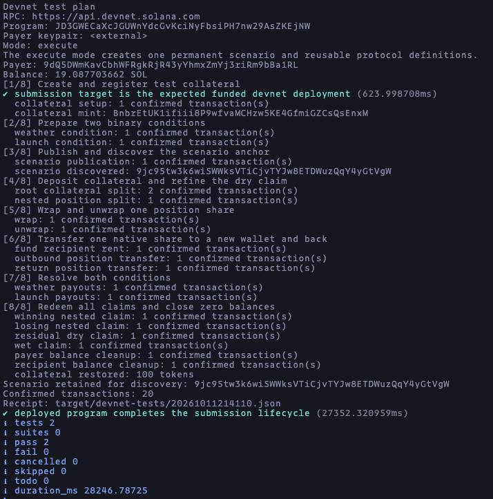

# cc-token

cc-token is a Solana program for collateral-backed combinatorial claims. A holder can split one
deposit across an outcome partition, refine a claim with more conditions, transfer or wrap the
resulting positions, and redeem them after resolution.

[Live devnet application](https://cc-token.vercel.app/#/live) ·
[Devnet program](https://explorer.solana.com/address/JD3GWECaXcJGUWnYdcGvKciNyFbsiPH7nw29AsZKEjNW?cluster=devnet) ·
[Worked examples](EXAMPLES.md)

## Protocol model

- A **condition** defines 2–256 outcomes, a resolver and an eventual payout vector.
- A **collection** composes outcome subsets through BN254 point addition. Composition order does
  not change its ID; repeated factors remain distinct.
- A **position** binds a collection to one collateral mint.
- A **balance** records one owner's native shares of a position.
- A **scenario** gives one canonical anchor position a discoverable name. It does not own funds or
  restrict a position to one scenario.
- A **wrapper** exchanges native shares one-for-one with a canonical Token-2022 mint.

A root split transfers collateral into the program vault and creates equal quantities of every
position in a complete partition. Intermediate splits consume a position and create its refined
children without moving collateral. Complete sets merge through the inverse transitions.

## Architecture



The program stores reusable definitions separately from holder balances. Every collection and
position registration recomputes its canonical identity. The SDK reconstructs a scenario by
verifying its anchor position and walking the registered collection parents, then intersects that
basis with native balances and canonical wrappers held by the wallet.

[Protocol architecture](docs/architecture.md) documents the actors, PDA seeds, account fields,
instruction groups, external programs, validation boundaries and client discovery flow. The
editable diagram source is
[docs/assets/cc-token-architecture.excalidraw](docs/assets/cc-token-architecture.excalidraw).

## Authority and value invariants

| Actor            | Authority                                                                                |
| ---------------- | ---------------------------------------------------------------------------------------- |
| Holder           | Signs every operation that consumes its collateral or position shares.                   |
| Resolver         | Reports the irreversible payout vector for one condition.                                |
| Scenario creator | Publishes and renames a discovery descriptor. It has no authority over position holders. |
| Payer            | Funds reusable accounts and gains no authority from doing so.                            |
| Recipient        | Can receive native or wrapped shares without approving the incoming transfer.            |

The program has no global administrator. The collateral vault is controlled only by its PDA.
Root operations require a complete partition, split and merge preserve share quantities, and
wrapper supply is backed one-for-one by escrowed native shares. Collateral with a freeze authority
is recorded as issuer-controlled and requires explicit acceptance before deposit.

## Web application

`apps/web/` contains three pages:

- **How it works** explains the claim model.
- **Simulator** runs an in-browser position graph and simulated market without transactions.
- **Live** discovers named scenarios from program accounts and uses the deployed devnet program.
  It supports scenario creation, deposit, split, merge, native transfer, wrap, unwrap, resolution
  and redemption. Scenario graphs are readable without a wallet.

Run it locally:

```sh
pnpm install --frozen-lockfile
pnpm build
pnpm dev:web
```

Open <http://localhost:5173>. The build produces the IDL used to regenerate the tracked Kit client.
[docs/devnet.md](docs/devnet.md) describes the live flows and optional server-side RPC proxy.

## Tests

The deterministic suite builds the SBPF v3 program and runs every local test layer:

```sh
pnpm test
```

| Command                 | Coverage                                                                                  |
| ----------------------- | ----------------------------------------------------------------------------------------- |
| `pnpm test:rust`        | Identity, partition, arithmetic and state primitives.                                     |
| `pnpm test:sdk`         | Client derivation, verification, transaction planning and execution recovery.             |
| `pnpm test:web`         | Graph, discovery, scenario, market, RPC proxy and display behavior.                       |
| `pnpm test:litesvm`     | Compiled-program instruction behavior, failures, rollback and account lifecycle.          |
| `pnpm test:integration` | Generated Kit clients and Live flows against an isolated local Agave validator.           |
| `pnpm test:devnet`      | Explicit opt-in smoke test against the deployed program with a disposable funded keypair. |

The devnet command performs a read-only preflight unless `--execute` is supplied:

```sh
pnpm test:devnet -- --payer .local/devnet-test-payer.json
pnpm test:devnet -- --payer .local/devnet-test-payer.json --execute
```

It verifies the cluster and program, publishes one submission scenario, and exercises collateral,
nested positions, transfer, wrappers, resolution and redemption. See
[docs/devnet.md](docs/devnet.md#deployed-program-submission-test) for RPC configuration and state
left by the test.



## Devnet deployment

| Field   | Value                                                                                                                                             |
| ------- | ------------------------------------------------------------------------------------------------------------------------------------------------- |
| Program | [`JD3GWECaXcJGUWnYdcGvKciNyFbsiPH7nw29AsZKEjNW`](https://explorer.solana.com/address/JD3GWECaXcJGUWnYdcGvKciNyFbsiPH7nw29AsZKEjNW?cluster=devnet) |
| Source  | [`bad5637`](https://github.com/neodyma/cc-token/commit/bad563728501223feb4be00739c96a90040278d5)                                                  |
| IDL     | Published on devnet; generated Kit clients are tracked under `packages/sdk/src/generated/`.                                                       |
| Record  | [`deployments/devnet.json`](deployments/devnet.json)                                                                                              |

[docs/deployment.md](docs/deployment.md) covers the pinned build, status checks, deployment dry
run, upgrade flow and recorded artifact hash.

```sh
pnpm deploy:devnet -- --offline
pnpm devnet:status
```

Neither command changes the global Solana CLI configuration. The repository does not create,
fund or store deployment authorities.

## Current scope

- Resolution depends on the resolver named when the condition is prepared.
- Splits, merges and redemptions operate on native balances. Wrappers provide Token-2022
  interoperability.
- The web application uses transaction v0 as its wallet compatibility baseline. Transaction v1
  remains an optional SDK path for larger operations.
- Large payout vectors use staged report accounts; the current web form submits direct reports of
  at most 96 outcomes.
- Scenario discovery scans fixed-size descriptors directly. Catalogue pages and reverse indexes
  are deferred until measured RPC scale requires them.
- Compression, yield adapters and an on-chain market maker are outside the deployed MVP.
- Browser-wallet flows have manual devnet coverage; automated runtime coverage uses LiteSVM and a
  local validator.

## Development

| Tool                         | Version |
| ---------------------------- | ------- |
| Anchor CLI and `anchor-lang` | 1.2.1   |
| Solana / Agave CLI           | 4.3.0   |
| Host Rust                    | 1.91.1  |
| Node.js                      | 24 LTS  |
| pnpm                         | 10.12.4 |

Install the pinned versions before building. With AVM available:

```sh
avm install 1.2.1
pnpm install --frozen-lockfile
pnpm build
pnpm check
pnpm test
pnpm format:check
```

```text
programs/cc_token/   Anchor program
packages/sdk/        Shared Kit client, generated bindings and transaction planning
apps/web/            Vite/React simulator and devnet application
tests/litesvm/       Compiled-program LiteSVM tests
scripts/             Build, deployment and integration-test runners
docs/                Architecture, API, runtime and deployment references
```
